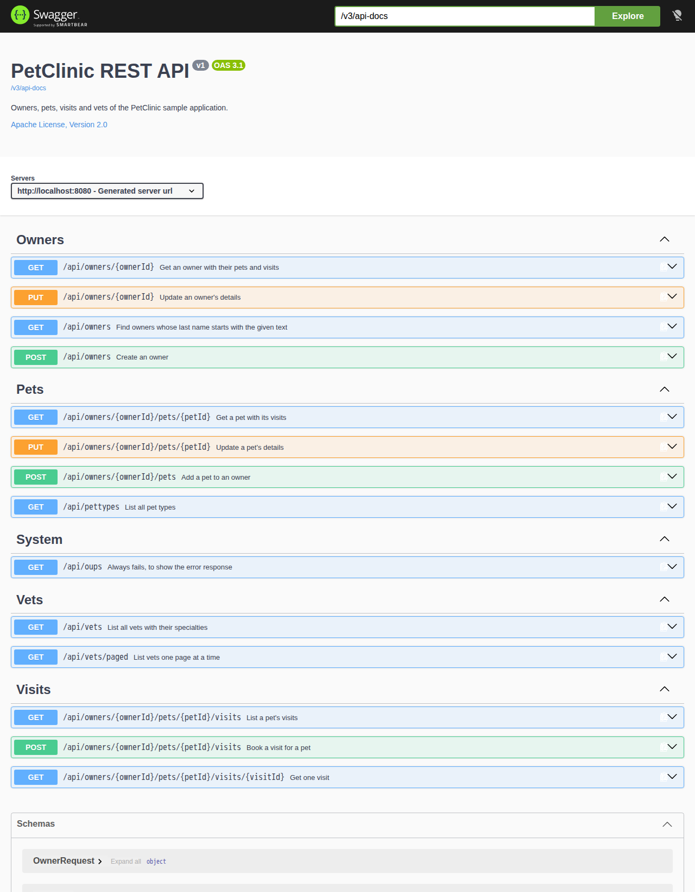

# Spring PetClinic Sample Application (REST API)

[](https://codespaces.new/Metasiteorg/java-coding-task/tree/petclinic)

> This is a modified copy of [spring-projects/spring-petclinic](https://github.com/spring-projects/spring-petclinic), licensed under the Apache License 2.0 (see [LICENSE.txt](LICENSE.txt)).

## Understanding the Spring Petclinic application with a few diagrams

See the presentation here:  
[Spring Petclinic Sample Application (legacy slides)](https://speakerdeck.com/michaelisvy/spring-petclinic-sample-application?slide=20)

> **Note:** These slides refer to a legacy, pre–Spring Boot version of Petclinic and may not reflect the current Spring Boot–based implementation.  
> For up-to-date information, please refer to this repository and its documentation.

## Run Petclinic locally

Spring Petclinic is a [Spring Boot](https://spring.io/guides/gs/spring-boot) application built using [Maven](https://spring.io/guides/gs/maven/) or [Gradle](https://spring.io/guides/gs/gradle/). Both wrappers are included, so use whichever you prefer.
Java 25 or later is required for the build, and the application runs with Java 25 or newer.

You first need to clone the project locally:

```bash
git clone -b petclinic git@github.com:Metasiteorg/java-coding-task.git
cd java-coding-task
```
If you are using Maven, you can start the application on the command-line as follows:

```bash
./mvnw spring-boot:run
```
With Gradle, the command is as follows:

```bash
./gradlew bootRun
```

There is no web UI. You access the application through Swagger UI at <http://localhost:8080/swagger-ui.html> (<http://localhost:8080/> redirects there). The OpenAPI document is at <http://localhost:8080/v3/api-docs>.



You can, of course, run Petclinic in your favorite IDE.
See below for more details.

## REST API

| Method | Path | Description |
|--------|------|-------------|
| `GET` | `/api/owners?lastName=&page=&size=` | Find owners whose last name starts with the given text (paged, 0-based `page`, default `size` 5) |
| `POST` | `/api/owners` | Create an owner |
| `GET` | `/api/owners/{ownerId}` | Get an owner with their pets and visits |
| `PUT` | `/api/owners/{ownerId}` | Update an owner's details |
| `POST` | `/api/owners/{ownerId}/pets` | Add a pet to an owner |
| `GET` | `/api/owners/{ownerId}/pets/{petId}` | Get a pet with its visits |
| `PUT` | `/api/owners/{ownerId}/pets/{petId}` | Update a pet's details |
| `GET` | `/api/owners/{ownerId}/pets/{petId}/visits` | List a pet's visits |
| `POST` | `/api/owners/{ownerId}/pets/{petId}/visits` | Book a visit for a pet |
| `GET` | `/api/owners/{ownerId}/pets/{petId}/visits/{visitId}` | Get one visit |
| `GET` | `/api/pettypes` | List all pet types |
| `GET` | `/api/vets` | List all vets with their specialties |
| `GET` | `/api/vets/paged?page=&size=` | List vets one page at a time |
| `GET` | `/api/oups` | Always fails, to show the error response |

For example, to book a visit:

```bash
curl -i -X POST http://localhost:8080/api/owners/1/pets/1/visits \
  -H 'Content-Type: application/json' \
  -d '{"date": "2030-01-15", "description": "rabies shot"}'
```

Successful `POST` requests return `201 Created` with a `Location` header. Validation errors return `400 Bad Request` as an [RFC 9457](https://www.rfc-editor.org/rfc/rfc9457) problem detail with one entry per invalid field. Error messages are translated using the `Accept-Language` header:

```json
{
  "title": "Bad Request",
  "status": 400,
  "detail": "Invalid request content.",
  "instance": "/api/owners/1/pets/1/visits",
  "errors": [
    { "field": "date", "message": "Visit date must be in the future" }
  ]
}
```

An unknown owner, pet or visit id returns `404 Not Found`, and a duplicate pet name returns `409 Conflict`, both as problem details.

## Building a Container

There is no `Dockerfile` in this project. You can build a container image (if you have a docker daemon) using the Spring Boot build plugin:

```bash
./mvnw spring-boot:build-image
```

## Running the Container Image

```bash
docker images | grep petclinic
docker run -p 8080:8080 docker.io/library/spring-petclinic:latest
```

## In case you find a bug/suggested improvement for Spring Petclinic

The upstream issue tracker is available [here](https://github.com/spring-projects/spring-petclinic/issues). Report problems specific to this REST version in this repository instead.

## Database configuration

In its default configuration, Petclinic uses an in-memory database (H2) which
gets populated at startup with data. The h2 console is exposed at `http://localhost:8080/h2-console`,
and it is possible to inspect the content of the database using the `jdbc:h2:mem:<uuid>` URL. The UUID is printed at startup to the console.

A similar setup is provided for MySQL and PostgreSQL if a persistent database configuration is needed. Note that whenever the database type changes, the app needs to run with a different profile: `spring.profiles.active=mysql` for MySQL or `spring.profiles.active=postgres` for PostgreSQL. See the [Spring Boot documentation](https://docs.spring.io/spring-boot/how-to/properties-and-configuration.html#howto.properties-and-configuration.set-active-spring-profiles) for more detail on how to set the active profile.

You can start MySQL or PostgreSQL locally with whatever installer works for your OS or use docker:

```bash
docker run -e MYSQL_USER=petclinic -e MYSQL_PASSWORD=petclinic -e MYSQL_ROOT_PASSWORD=root -e MYSQL_DATABASE=petclinic -p 3306:3306 mysql:9.7
```

or

```bash
docker run -e POSTGRES_USER=petclinic -e POSTGRES_PASSWORD=petclinic -e POSTGRES_DB=petclinic -p 5432:5432 postgres:18.4
```

Further documentation is provided for [MySQL](src/main/resources/db/mysql/petclinic_db_setup_mysql.txt)
and [PostgreSQL](src/main/resources/db/postgres/petclinic_db_setup_postgres.txt).

Instead of vanilla `docker` you can also use the provided `docker-compose.yml` file to start the database containers. Each one has a service named after the Spring profile:

```bash
docker compose up mysql
```

or

```bash
docker compose up postgres
```

## Test Applications

At development time we recommend you use the test applications set up as `main()` methods in `PetClinicIntegrationTests` (using the default H2 database and also adding Spring Boot Devtools), `MySqlTestApplication` and `PostgresIntegrationTests`. These are set up so that you can run the apps in your IDE to get fast feedback and also run the same classes as integration tests against the respective database. The MySql integration tests use Testcontainers to start the database in a Docker container, and the Postgres tests use Docker Compose to do the same thing.

Run the tests with `./mvnw test` or `./gradlew test`.

## Working with Petclinic in your IDE

### Prerequisites

The following items should be installed in your system:

- Java 25
- [Git command line tool](https://help.github.com/articles/set-up-git)
- Your preferred IDE
  - Eclipse with the m2e plugin. Note: when m2e is available, there is a m2 icon in `Help -> About` dialog. If m2e is
  not there, follow the installation process [here](https://www.eclipse.org/m2e/)
  - [Spring Tools Suite](https://spring.io/tools) (STS)
  - [IntelliJ IDEA](https://www.jetbrains.com/idea/)
  - [VS Code](https://code.visualstudio.com)

Alternatively, open the repository in GitHub Codespaces or in VS Code with the Dev Containers extension. The dev container in [.devcontainer](.devcontainer) comes with Java 25 and downloads the Maven and Gradle dependencies when it is created.

### Steps

1. On the command line run:

    ```bash
    git clone -b petclinic git@github.com:Metasiteorg/java-coding-task.git
    ```

1. Inside Eclipse or STS:

    Open the project via `File -> Import -> Maven -> Existing Maven project`, then select the root directory of the cloned repo.

    Run the application's main method by right-clicking on it and choosing `Run As -> Java Application`.

1. Inside IntelliJ IDEA:

    In the main menu, choose `File -> Open` and select the Petclinic [pom.xml](pom.xml) (or [build.gradle](build.gradle) if you prefer Gradle). Click on the `Open` button.

    - A run configuration named `PetClinicApplication` should have been created for you if you're using a recent Ultimate version. Otherwise, run the application by right-clicking on the `PetClinicApplication` main class and choosing `Run 'PetClinicApplication'`.

1. Navigate to the Petclinic API

    Visit [http://localhost:8080/swagger-ui.html](http://localhost:8080/swagger-ui.html) in your browser.

## Looking for something in particular?

|Spring Boot Configuration | Class or Java property files  |
|--------------------------|---|
|The Main Class | [PetClinicApplication](src/main/java/org/springframework/samples/petclinic/PetClinicApplication.java) |
|Properties Files | [application.properties](src/main/resources) |
|Caching | [CacheConfiguration](src/main/java/org/springframework/samples/petclinic/system/CacheConfiguration.java) |
|OpenAPI / Swagger UI | [OpenApiConfiguration](src/main/java/org/springframework/samples/petclinic/system/OpenApiConfiguration.java) |
|Error responses | [RestExceptionHandler](src/main/java/org/springframework/samples/petclinic/system/RestExceptionHandler.java) |

## Interesting Spring Petclinic branches and forks

The Spring Petclinic "main" branch in the [spring-projects](https://github.com/spring-projects/spring-petclinic)
GitHub org is the "canonical" implementation based on Spring Boot and Thymeleaf. There are
[quite a few forks](https://spring-petclinic.github.io/docs/forks.html) in the GitHub org
[spring-petclinic](https://github.com/spring-petclinic). If you are interested in using a different technology stack to implement the Pet Clinic, please join the community there.

## Interaction with other open-source projects

One of the best parts about working on the Spring Petclinic application is that we have the opportunity to work in direct contact with many Open Source projects. We found bugs/suggested improvements on various topics such as Spring, Spring Data, Bean Validation and even Eclipse! In many cases, they've been fixed/implemented in just a few days.
Here is a list of them:

| Name | Issue |
|------|-------|
| Spring JDBC: simplify usage of NamedParameterJdbcTemplate | [SPR-10256](https://github.com/spring-projects/spring-framework/issues/14889) and [SPR-10257](https://github.com/spring-projects/spring-framework/issues/14890) |
| Bean Validation / Hibernate Validator: simplify Maven dependencies and backward compatibility |[HV-790](https://hibernate.atlassian.net/browse/HV-790) and [HV-792](https://hibernate.atlassian.net/browse/HV-792) |
| Spring Data: provide more flexibility when working with JPQL queries | [DATAJPA-292](https://github.com/spring-projects/spring-data-jpa/issues/704) |

## Contributing

For pull requests, editor preferences are available in the [editor config](.editorconfig) for easy use in common text editors. Read more and download plugins at <https://editorconfig.org>.

## License

The Spring PetClinic sample application is released under version 2.0 of the [Apache License](https://www.apache.org/licenses/LICENSE-2.0). This modified version is distributed under the same license.
